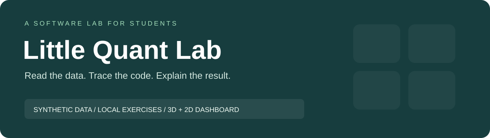

# Quant Pi Trading Demo · Little Quant Lab

**Learn how a small data program is organized, using invented data and a local classroom dashboard.**

This repository is for students who want to read a CSV, follow a simple calculation, trace a simulation, test boundary cases, and explain a result. The historical repository name is retained; **a Raspberry Pi is not needed**. All exercises run on your own computer.

학생을 위한 작은 소프트웨어 실습실입니다. [한국어 시작 안내](docs/START_HERE.ko.md)에서 설치 확인부터 실행 결과·문제 해결까지 따라갈 수 있습니다. 예제는 공개된 간단한 규칙과 합성 자료만 사용하며 개인 운용 시스템과 연결되지 않습니다.

<p><a href="docs/START_HERE.md">Start here — English</a> · <a href="docs/START_HERE.ko.md">처음 시작 — 한국어</a> · <a href="docs/LABS.ko.md">실습 과제</a> · <a href="docs/SOLUTIONS.ko.md">해설</a> · <a href="docs/teaching_notes.md">For instructors</a></p>

## See the lab


*Fresh local browser capture, 2026-10-21. Teammates, prices and activity are invented. The 3D view uses pinned Three.js; the 2D path works without that CDN request.*

## Choose a learning path

| Lesson | What you learn | Read / run |
| --- | --- | --- |
| 1 · One calculation | CSV input, validation, a short average versus a full-sample average | [Signal walkthrough](docs/CODE_WALKTHROUGH.md) · `src/demo_signal.py` |
| 2 · Time and state | Warm-up, decisions, next-observation processing, cash and equity | [Backtest lab](docs/BACKTEST.md) · `src/demo_backtest.py` |
| 3 · A local report | Date windows, sorting, pure rendering and optional file output | [Event-report guide](docs/event_alert_demo.md) · `src/demo_event_alert.py` |
| 4 · An interactive view | JSON state, browser events, selection, playback and 2D fallback | [Dashboard guide](docs/dashboard_3d.md) · [한국어](docs/dashboard_3d.ko.md) |
| 5 · Explain and test | Boundary cases, causal ordering, reproducibility and scope | [Exercises](docs/LABS.ko.md) · [Answers](docs/SOLUTIONS.ko.md) · [Tests](tests/test_classroom.py) |

## Quick start

Python **3.10 or newer** is required. The Python demos use the standard library; no `pip install`, account, API key or `.env` setup is needed. Download ZIP or clone the complete repository, open a terminal in its root, then run:

```console
python src/demo_dashboard.py
```

Open **http://127.0.0.1:8000/** on the same computer. Stop with **Ctrl+C**. For a fully local view, use **http://127.0.0.1:8000/?view=2d**. Windows users can replace `python` with `py -3` when that launcher is installed. [Troubleshooting](docs/START_HERE.ko.md).

The command-line lessons are independent of the dashboard:

```console
python src/demo_signal.py --prices examples/synthetic_prices.csv
python src/demo_backtest.py --prices examples/synthetic_prices.csv
python src/demo_event_alert.py --calendar examples/corporate_events.csv --today 2026-05-21 --lookahead-days 14
```

The fixed report date makes the invented calendar reproducible. The dashboard has its own 12-value JSON series; the CSV examples have ten rows. Changing one does not automatically update the other.

## What the software actually does

The scripts read local fixtures, calculate values and print text. The event demo optionally writes two local preview files. The dashboard serves four public assets on loopback and runs a scripted workflow in the browser. There is no broker client, account connection, message delivery or remote device connection.

`BUY`, `HOLD`, and `FLAT` are toy program labels with meanings documented in the guides. The moving averages are already-public classroom arithmetic, not private research or a strategy recommendation. The backtest now processes a decision at the **next observation's close**; costs, slippage and market execution are not modeled. Its numbers are expected software outputs on invented data.

## Verify your copy

```console
python -m unittest discover -s tests -v
python tools/validate_documentation.py
python tools/check_publication.py
```

Optional JavaScript checks use Node.js, with no npm dependencies:

```console
node --check examples/dashboard_3d/app.js
node tests/test_dashboard_state.cjs
```

The maintenance pass verified **22 Python tests, nine state-validation cases, and 11 browser checks**, including 3D rendering, intentional 2D mode and mobile layout. See [validation evidence](docs/VALIDATION.md), [repair notes](docs/REPAIRS.md), [file guide](docs/FILE_GUIDE.md), and [public boundary](docs/PUBLIC_BOUNDARY.md).

## License and credits

The repository uses the [MIT license](LICENSE). The classroom scene consists of independently authored basic shapes; Three.js retains its own [MIT license](https://github.com/mrdoob/three.js/tree/r160). Source fixtures are invented, and new screenshots show only those fixtures. [Asset provenance](assets/SOURCES.md) · [Educational scope](docs/disclaimer.md).
