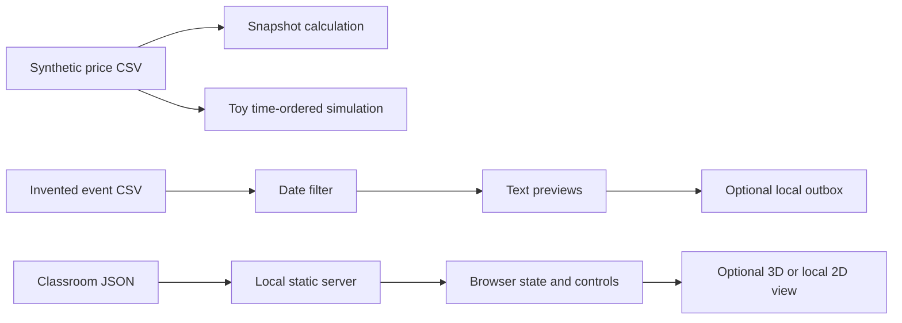

# The implemented classroom architecture

[Home](../README.md) · [File guide](FILE_GUIDE.md) · [Public boundary](PUBLIC_BOUNDARY.md)

These are the actual local entry points. No private operational topology is represented. The CLI lessons and browser dashboard run independently; arrows do not imply an integration that has not been implemented.

| Boundary | What crosses it | Where to inspect |
| --- | --- | --- |
| Disk → Python | CSV fields | load functions in src |
| Pure functions → console | Dictionaries/events/text | main functions |
| Python → disk, opt-in | Two preview text files | write_outbox |
| Local server → browser | Four public classroom assets | DashboardHandler allowlist |
| Browser → CDN, 3D only | Requests for pinned Three.js modules | import map and buildScene |

There is no market-data downloader, live worker scheduler, account handoff, backend signal endpoint, device connection or message delivery. `.env.example` is illustrative and is not read by the scripts. The lesson is understandable entirely from its public fixtures and code.
