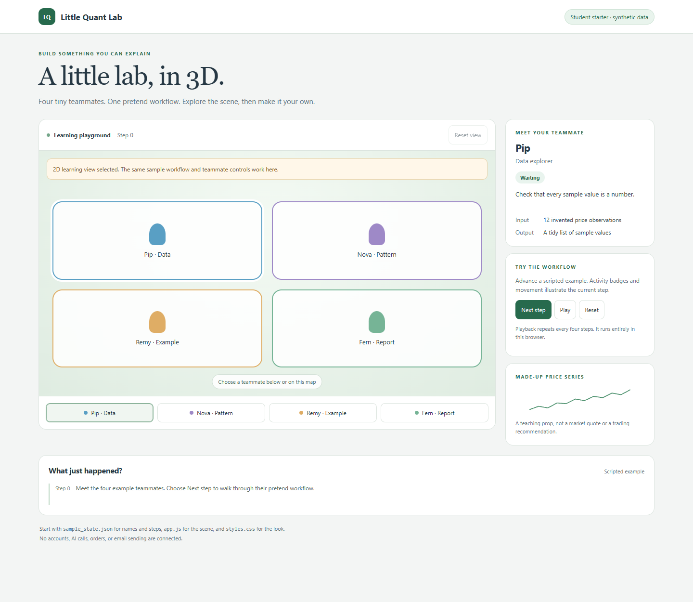

# 학생용 3D/2D 대시보드 읽기와 수정

[처음 화면](../README.md) · [English guide](dashboard_3d.md) · [전체 시작 안내](START_HERE.ko.md)

이 화면은 Pip·Nova·Remy·Fern 네 가상 캐릭터가 예시 작업을 설명하는 수업용 장면입니다. 실제 직원·AI 에이전트·서버 작업 상태를 관찰하지 않습니다. 화면은 기본 도형으로 만들었으며 캐릭터 모델 다운로드나 유료 서비스가 필요하지 않습니다.

## 실행과 종료

저장소 루트에서 `python src/demo_dashboard.py`를 실행한 뒤 같은 PC의 브라우저로 http://127.0.0.1:8000/를 엽니다. 종료는 서버 터미널의 Ctrl+C입니다. 포트 변경·Python 명령·파일 오류는 [시작 안내](START_HERE.ko.md)를 확인하세요.

3D 장면은 Three.js 0.160.0과 대응 OrbitControls를 CDN에서 가져옵니다. 인터넷 없이 진행하려면 http://127.0.0.1:8000/?view=2d를 여세요. 이 경로는 3D import를 건너뛰며 캐릭터 선택·그래프·단계 진행이 가능합니다. 아래는 같은 합성 상태의 2D 화면입니다.

## 조작해 보기

| 조작 | 확인할 변화 |
| --- | --- |
| 캐릭터/자리 클릭 | 오른쪽 역할·입력·출력·설명이 바뀜 |
| 아래 캐릭터 버튼 | 같은 선택을 키보드로도 수행 |
| 마우스 드래그·휠 | 3D 시점 회전·확대 축소 |
| Next step | data → signal → review → report 예시를 한 단계 진행 |
| Play/Pause | 약 2.5초 간격으로 진행하거나 중지 |
| Reset | 단계 0·초기 선택·기록·시점으로 복원 |
| Reset view | 3D 카메라만 복원; 2D에서는 사용하지 않음 |

활동 기록은 최근 5개를 표시합니다. 단계는 예시 메시지의 순환이며 네 번 진행해도 실제 업무가 수행되거나 파일이 만들어지는 것은 아닙니다. 모바일에서는 같은 구성요소가 세로로 이어집니다.

## 어떤 파일을 고칠까?

| 파일 | 담당 |
| --- | --- |
| [sample_state.json](../examples/dashboard_3d/sample_state.json) | 가상 이름·역할·색·위치·가격·단계 문장 |
| [index.html](../examples/dashboard_3d/index.html) | 문서·버튼·정보 영역·import map |
| [styles.css](../examples/dashboard_3d/styles.css) | 색·간격·화면 크기별 배치 |
| [app.js](../examples/dashboard_3d/app.js) | 상태 검증·선택·기록·재생·장면·대체 화면 |
| [demo_dashboard.py](../src/demo_dashboard.py) | 자기 PC에만 연결하는 정적 파일 서버 |

먼저 JSON의 `name`이나 `task` 하나를 바꾸고 저장한 뒤 새로고침하세요. 처음부터 장면 코드 전체를 바꾸기보다 작은 수정의 결과를 관찰하는 편이 원인을 찾기 쉽습니다.

## JSON에서 지켜야 하는 조건

- `demo_only`는 true입니다.
- `prices`는 유한 숫자 3개 이상입니다. 이 페이지의 기본값은 12개이며 CLI의 10행 CSV와 독립입니다.
- `agents`와 `steps`는 각각 한 항목 이상입니다.
- 각 agent의 id는 비어 있지 않은 고유 문자열입니다.
- name·role·input·output·task는 문자열입니다.
- color는 `#` 뒤에 16진수 여섯 자리이고 position은 숫자 두 개 `[x, z]`입니다.
- 각 step의 agent는 존재하는 id여야 하며 status·message는 문자열입니다.

검증을 통과해야 진행 버튼이 활성화됩니다. 화면 텍스트는 textContent로 표시하며 JSON의 문자열을 HTML로 실행하지 않습니다. 그래도 실제 개인 기록·로그·계정 정보는 샘플에 넣지 않습니다.

## 다섯 번째 캐릭터 추가 순서

1. 기존 agent 항목 하나를 복사합니다.
2. id를 고유하게 바꾸고 이름·역할·입력·출력·설명을 합성 내용으로 씁니다.
3. 기존 자리와 겹치지 않는 `[x, z]`를 고릅니다.
4. steps에 같은 id를 가리키는 항목을 추가합니다.
5. 버튼 배치와 모바일 화면을 확인합니다.
6. `node tests/test_dashboard_state.cjs`는 원래 네 캐릭터 fixture 기준의 검사도 포함하므로, 확장 시 수업 요구에 맞는 새 검사를 별도로 작성합니다.

## 로컬 서버가 제공하는 범위

서버는 index.html·styles.css·app.js·sample_state.json 네 파일만 제공합니다. 저장소 루트나 다른 파일·폴더의 목록을 제공하는 범용 파일 서버로 사용하지 않습니다. 서버 주소는 같은 PC에서 실습하기 위한 loopback이며 소유자의 장치 주소와 무관합니다. 다른 장치나 운영 서버에 연결하는 절차는 이 교재에 없습니다.

원격 배포나 실제 계정 연동 대신 [합성 데이터 과제](LABS.ko.md)를 진행하세요. [공개 범위](PUBLIC_BOUNDARY.md) · [검증 결과](VALIDATION.md).
