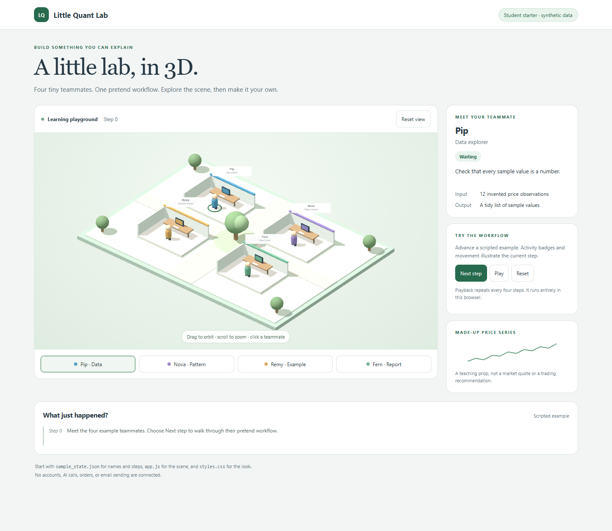

# Student 3D Dashboard Starter

[Home](../README.md) · [한국어 상세 안내](dashboard_3d.ko.md) · [Student start](START_HERE.md) · [Exercises](LABS.ko.md)

This is a small, independent classroom example of a 3D dashboard. Four fictional teammates sit in an open lab. Click a teammate to see its role, rotate the scene, and advance a scripted workflow. Names, prices and activity are invented. The scene is made with basic shapes; no character downloads, private campus files or paid AI service are required.

## Run it

1. Install Python 3.10 or newer. Use a current Chrome, Edge, Firefox or Safari browser with WebGL enabled.
2. Clone this repository, or choose GitHub **Code → Download ZIP** and extract the ZIP.
3. Open a terminal in the repository folder and run:

   ```bash
   python src/demo_dashboard.py
   ```

   On Windows, if `python` is unavailable but the Python launcher is installed:

   ```powershell
   py -3 src/demo_dashboard.py
   ```

4. Open **http://127.0.0.1:8000/** in your browser. Press **Ctrl+C** in the terminal to stop.

No `pip install`, npm setup, API key, brokerage account or Raspberry Pi is needed. Run the command from any directory by giving the full path to the script. If port 8000 is already in use, add `--port 8001` and use the address printed in the terminal.

The first 3D load needs internet access: the browser requests pinned **Three.js 0.160.0** and its matching OrbitControls module from jsDelivr. Sample data stays on your local server and in your browser; the app has no remote data upload code. Browser requests to the CDN have the usual network metadata. A completely disconnected browser can use **http://127.0.0.1:8000/?view=2d**, including selection, sample prices and workflow controls.

Do not double-click `index.html`: browsers can block its local JSON request under `file://`. Use the provided local server. The server binds to **127.0.0.1** and serves only `examples/dashboard_3d/`, rather than your repository, desktop or home directory. It is a classroom development server; deploying it publicly requires a separate hosting design.

## Explore the example

| Control | What to try |
| --- | --- |
| Drag / scroll | Orbit / zoom the 3D lab; two-finger gestures also work |
| Click a person or station | Select the teammate; the four buttons provide keyboard access too |
| Next step | Advance the scripted data → pattern → review → report cycle |
| Play / Pause | Advance automatically, once every 2.5 seconds / stop advancing |
| Reset | Clear the activity history, return to step 0 and reset the view |
| Reset view | Restore the initial camera angle and zoom |

The activity labels are **illustrations**, not observations of real workers or running jobs. The toy averages describe a made-up series and do not establish a profitable strategy. Changing steps does not place orders, call an AI model, send email or save a file.

If WebGL or the CDN is unavailable, the page explains the problem and switches to a 2D map. Selection, the chart, steps and playback continue to work. If the sample JSON is invalid, the page reports the error and leaves the simulation disabled.

## Read and change the code

```text
examples/dashboard_3d/
  index.html          Page structure and pinned import map
  styles.css          Layout, colors and mobile breakpoints
  sample_state.json   Fictional names, positions, roles, prices and workflow steps
  app.js              Selection, playback, 3D shapes and fallback behavior
src/demo_dashboard.py Local server using the Python standard library
```

Start with one small edit, refresh, and observe what changed:

1. Rename a teammate or change its `task` in `sample_state.json`.
2. Change a teammate's `color` (six-digit hex) or `position` (`[x, z]` coordinates).
3. Replace the invented prices with a different **synthetic** series. Notice how the chart rescales.
4. Change the four messages in `steps`. Keep every step's `agent` equal to an existing agent ID.
5. Find the **Begin editing here** comment in `app.js` and change a desk or building shape.
6. Add a fifth agent with a unique ID and the same fields as the others; give it a free position and a workflow step. Adjust the button grid in `styles.css` if needed.

The browser updates text with `textContent`, not HTML injection. Sample validation checks unique IDs, role text, valid colors, numeric positions, prices and step references. The rendered geometry and workflow are deliberately separate: state changes select a teammate, and the animation illustrates that state.

## Small learning exercises

- Make a data-science lab, library or ecology classroom by editing only the JSON.
- Add a new status color; explain the difference between a configured state and an observed state.
- Replace the scripted workflow with a local mock JSON producer. Keep a visible **mock** label and handle missing/stale data explicitly.
- Test the mobile layout, keyboard-only teammate selection, and the `?view=2d` path.

This starter is a visual teaching tool. It does not include the private production dashboard, actual organizational mappings, account snapshots, proprietary strategy parameters or operational endpoints. Do not put credentials or personal records in browser code or sample JSON.

## 한국어 빠른 시작

GitHub에서 ZIP을 내려받아 압축을 풀고, 저장소 폴더에서 `python src/demo_dashboard.py`를 실행하세요. Windows에서는 `py -3 src/demo_dashboard.py`도 가능합니다. 브라우저로 **http://127.0.0.1:8000/**를 열면 됩니다. 종료는 터미널에서 **Ctrl+C**입니다.

캐릭터를 눌러 역할을 보고, **Next step**으로 가상의 작업 흐름을 진행해 보세요. 먼저 `sample_state.json`의 이름·색상·설명을 바꿔 보는 것이 좋습니다. 모든 가격과 활동은 학습용 가짜 자료이며 실제 거래나 AI 호출은 연결되어 있지 않습니다. 첫 3D 로딩에는 인터넷이 필요하고, 연결이 없으면 `?view=2d`를 주소 뒤에 붙여 대체 화면을 사용할 수 있습니다.

## References and license

- [Three.js installation guide](https://threejs.org/manual/#en/installation)
- [Three.js source and MIT license](https://github.com/mrdoob/three.js/tree/r160)
- [Repository license](../LICENSE)

The starter code and shapes were authored independently for this demo. No original reference-office code, downloaded character models, production campus source or embedded personal work history is redistributed. Three.js is loaded from its CDN and retains its own MIT license.

## Fresh classroom evidence

The [verification record](VALIDATION.md) includes actual 3D, intentional 2D and mobile browser checks. The local server now allows exactly the four named dashboard assets. See [public boundaries](PUBLIC_BOUNDARY.md) before extending the lesson.


